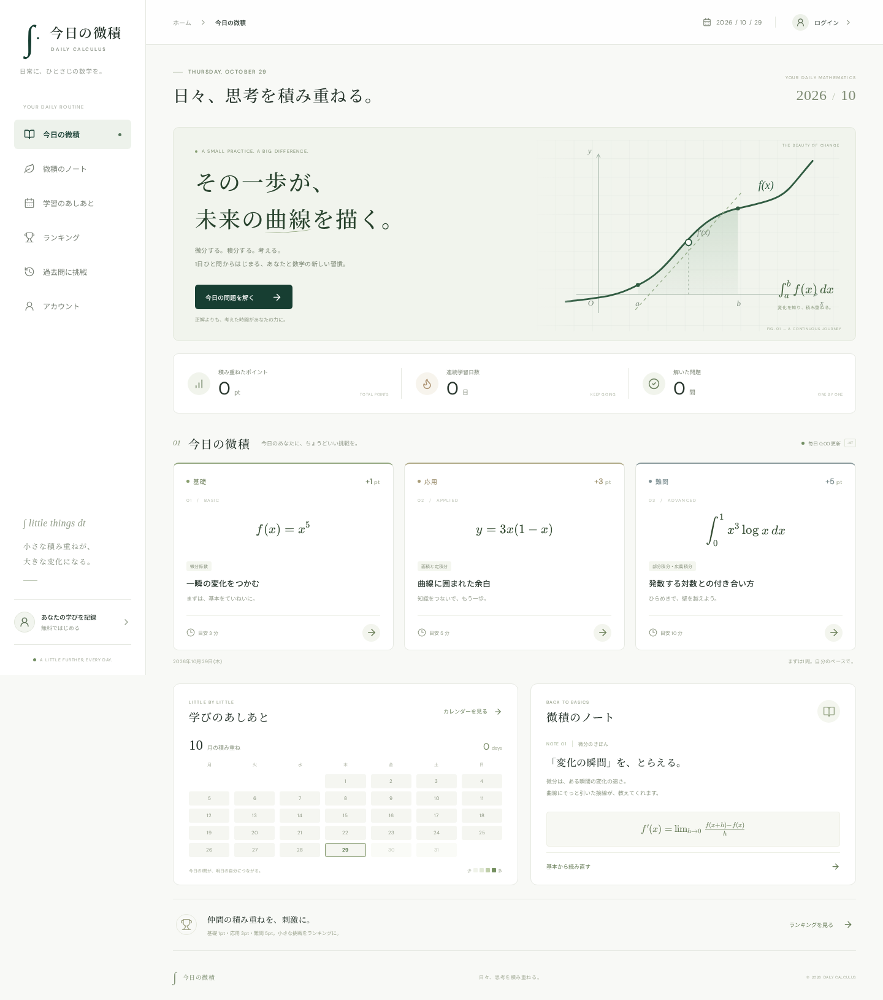

# 今日の微積 / Daily Calculus

1日1問、思考を積み重ねるための微積学習アプリ。白を基調に、座標軸と曲線、数式を取り入れたデザインです。

## できること

- **今日の微積**：毎日、基礎・応用・難関の3問に挑戦できます。選択式の解答、ヒント、解説を用意しています。
- **微積のノート**：極限・微分・積分の基本を数式とともに確認できます。
- **学習カレンダー**：正答した日、解いた問題数、ポイント、継続日数を記録します。
- **ランキング**：ユーザーネームとポイントを表示。総合・週間とも最大25人を表示し、圏外でも自分の順位を確認できます。同点は同じ順位です。
- **過去問**：直近30日分の日替わり問題に難易度別で挑戦できます。
- **アカウント**：ユーザーネームと数字4桁のパスワードで登録・ログインできます。

ゲストでも問題を解き、解説を読めます。ポイント・学習記録の保存にはログインが必要です。ランキングに架空のユーザーは登録していません。

## ローカルで起動

Node.js **24以上**を使用してください。組み込みの `node:sqlite` を利用します。

```sh
npm ci
npm run dev
```

ブラウザーで <http://localhost:5173> を開きます。開発時は Vite が画面を、ポート3001の Express がAPIを提供します。通常、開発時の環境変数設定は不要です。

```sh
npm test
npm run build
```

ブラウザーで登録から解答・記録反映・再ログインまで検証するには：

```sh
npx playwright install chromium
npm run test:e2e
```

E2E テストは専用の `data/e2e.sqlite` とポート3100を使用します。

`npm test` は問題の生成・数式、登録とログイン、ポイントの重複防止、週間ランキング、日本時間の日付境界、データの永続化などを検証します。`npm run build` は TypeScript の型検査と画面の本番ビルドを行います。

本番ビルドをローカルの HTTP で確認する場合：

```sh
npm run build
COOKIE_SECURE=false npm start
```

<http://localhost:3001> で確認できます。`COOKIE_SECURE=false` はローカルの HTTP 確認用です。

## 本番実行とデータ保存

公開デプロイは行っていません。本番では、**Node.js 24以上を常時実行できる、永続ディスク付きの環境**と HTTPS を用意してください。ローカル SQLite ファイルへ書き込む構成のため、現在のままでは Vercel Functions などの一時ファイルシステムを使う実行環境には適しません。

```sh
npm ci
npm run build
cp .env.example .env
# .env 内の DATABASE_PATH などを利用環境に合わせて編集
set -a
. ./.env
set +a
npm start
```

`.env` は自動では読み込みません。上の手順でシェルへ読み込むか、ホスティングサービスの環境変数設定を利用してください。`npm start` が `tsx` を使うため、現構成では開発依存も含めてインストールします。

| 変数            | 既定値・用途                                                           |
| --------------- | ---------------------------------------------------------------------- |
| `DATABASE_PATH` | `data/daily-calculus.sqlite`。永続ディスク上の書き込み可能なパスを指定 |
| `PORT`          | `3001`。本番では画面とAPIを同じポートから配信                          |
| `COOKIE_SECURE` | 本番は `true` が既定。HTTPS 接続でのみセッション Cookie を送信         |
| `TRUST_PROXY`   | 既定は無効。信頼できるリバースプロキシ1台の背後でのみ `1` に設定       |

SQLite は WAL モードです。単一のアプリプロセスと永続ボリュームでの運用を想定しています。バックアップ時はアプリを停止し、データディレクトリ全体を保管してください。アカウント・セッション・正答記録はデータベースに保存され、再起動しても保持されます。

## ポイントと日付のルール

- 基礎は **1pt**、応用は **3pt**、難関は **5pt**。正答時にサーバーで加点します。
- 同じアカウントの同じ問題への加点は1回だけです。復習や同時送信による重複加点を防ぎます。
- 不正解では加点されません。解説を読んで再挑戦し、後から正答することもできます。
- 日替わりは **日本時間の午前0時**。週間ランキングは **日本時間の月曜日午前0時**から集計します。
- 過去問のポイントは、問題の出題日ではなく実際に正答した日の週間ポイントに入ります。
- 継続日数は正答した日を数えます。今日まだ解いていなくても、昨日までの連続記録は維持されます。

## 実装範囲

画面は React / Vite / TypeScript、数式表示は KaTeX、API は Express、保存は SQLite です。問題は日付から決まる **15種類のテンプレートと数値の組み合わせ**で生成します。毎日新しい作問を外部から配信する仕組みや、実際の大学入試問題の収録はありません。テンプレートと数値が一巡すると同じ内容が再登場します。画面の過去問一覧は直近30日、API は過去365日以内の日付指定に対応します。

数字4桁のパスワードは要件に合わせた簡易認証です。ソルト付き scrypt で保存し、セッションは HttpOnly / SameSite Cookie を利用します。ログインは同一ユーザーネームで5回失敗すると制限し、同一IPでも15分間30回までに制限します。ユーザーネーム単位の制限は、最初の試行から15分経過すると解除されます。制限カウンターはプロセスのメモリー上にあり、再起動でリセットされます。複数インスタンスで共有する制限、メールによるパスワード再発行、アカウント削除は未実装です。

## 画面プレビュー

[デスクトップ](docs/screenshots/desktop.png) · [スマートフォン](docs/screenshots/mobile.png)


